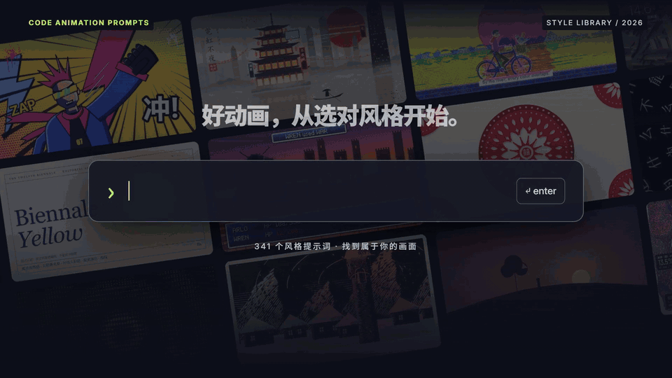
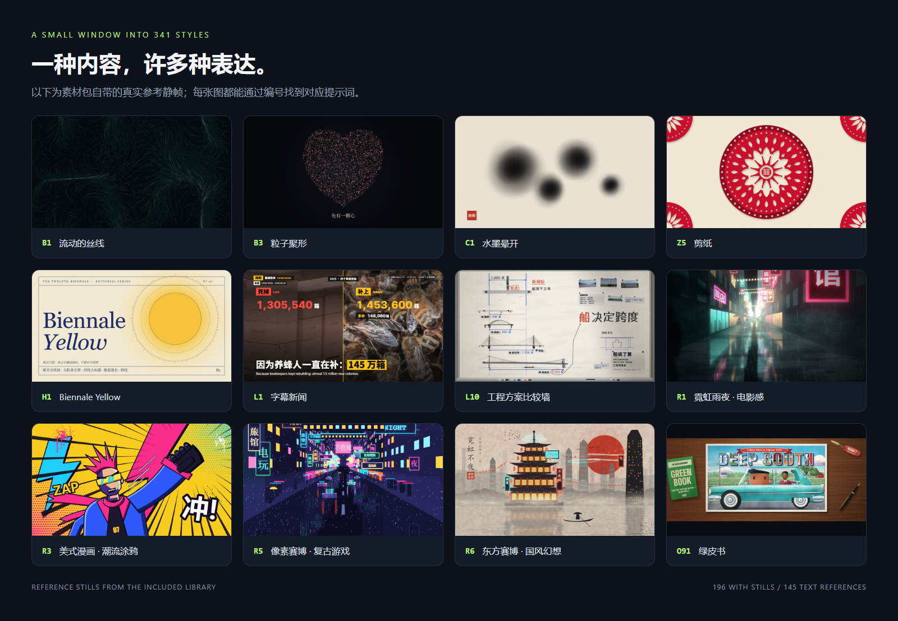
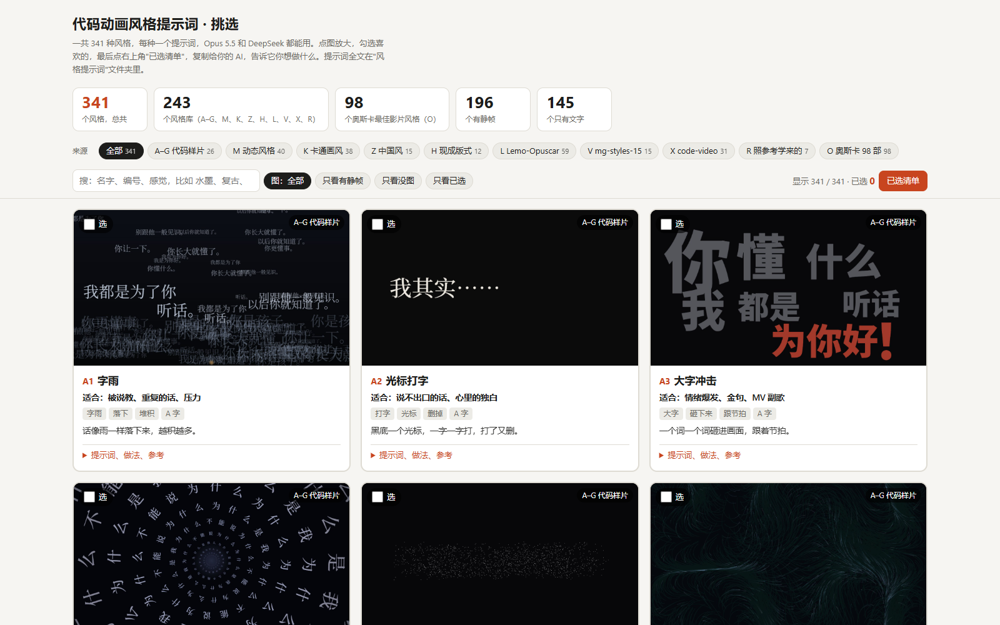
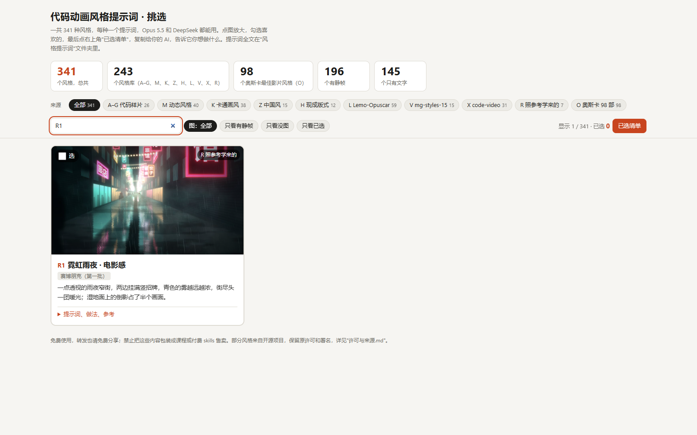

<div align="center">



# Code Animation Prompts

**한 문장의 아이디어에서, 스타일 있는 코드 애니메이션으로.**

341가지 스타일 프롬프트 · 196장 참고 스틸 · 10개 시리즈 · Claude Code & Codex Skill

[](docs/STYLES.ko.md)
[](docs/images/style-gallery.png)
[](skills/code-animation-prompts/SKILL.md)
[](LICENSE.md)

[전체 스타일 둘러보기](docs/STYLES.ko.md) · [원클릭 설치](#원클릭-설치-claude-code--codex) · [수동 설치](docs/INSTALL.ko.md) · [원본 예시](skills/code-animation-prompts/assets/library/示例) · [출처 및 라이선스](LICENSE.md)

[中文](README.md) · **한국어**

</div>

## 먼저 스타일부터

입자, 네온, 수묵, 종이공예, 만화, 영화적 연출…… 마음에 드는 화면을 AI에게 맡기고, 코드로 움직이게 하세요.

> 이 문서는 저장소 안내 문서의 한국어 번역입니다. 스타일 프롬프트 원문과 오프라인 선택기 화면은 중국어로 제공되며, 스타일 이름은 한국어로 번역해 두었습니다.



위 이미지는 소재 패키지에 포함된 참고 스틸이며, 번호가 프롬프트와 1:1로 대응합니다. **196가지에는 이미지가 있고, 145가지는 텍스트 참고입니다.** 스틸은 시각적 방향을 보여줄 뿐이며, 실제 애니메이션은 내용, 구현, 렌더링 결과에 따라 달라집니다.

| 만들고 싶은 것 | 여기서 시작해 보세요 |
|---|---|
| 따뜻한 입자 내러티브／오프닝 | **B3** 입자 응집, **B2** 반딧불과 빛의 먼지 |
| 동양풍 오프닝／명절 영상 | **Z5** 종이공예, **Z1** 수묵, **Z8** 둔황 |
| 테크／사이버 도시 | **R1** 네온 비의 밤, **R5** 픽셀 사이버, **R6** 동양 사이버 |
| 과학／지식 설명 | **M1** 화이트보드 손그림 설명, **L10** 엔지니어링 방안 비교 월 |
| 만화 단편／강한 임팩트 | **R3** 미국 만화, **X7** 히어로 만화 |
| 잡지 스타일 레이아웃／영화적 비주얼 참고 | **H1** Biennale Yellow, **O** 시리즈 |

## 무엇이 들어 있나요

| 구성 | 활용 방법 |
|---|---|
| **소재 라이브러리와 커뮤니티 보충** | 341개의 Markdown 프롬프트를 읽고, 스틸·참고 구현·원본 예시를 확인 |
| **오프라인 스타일 선택기** | 검색, 카테고리 필터, 이미지 확대, 스타일 선택, 선택 목록 내보내기 |
| **설치 가능한 Agent Skill** | Claude Code／Codex가 필요할 때 스타일을 읽고, 샷을 기획하고, 코드 애니메이션을 제작 |
| **가벼운 검색 스크립트** | 번호·키워드·시리즈로 찾기. 라이브러리 전체를 컨텍스트에 넣을 필요 없음 |
| **브라우저 렌더링 도구** | 시간 인터페이스를 제공하는 HTML을 프레임 단위로 MP4로 내보내고, 기존 오디오를 합칠 수 있음 |
| **원클릭 설치 프롬프트** | 로컬 파일과 터미널 권한이 있는 Claude Code／Codex에 붙여 넣어 다운로드와 설치를 완료 |

## 원클릭 설치: Claude Code / Codex

**아래 전체를 복사해 Claude Code 또는 Codex에 붙여 넣으세요:**

```text
https://github.com/XiaoyeCodes/code-animation-prompts 를 현재 코딩 어시스턴트에서 사용할 수 있는 skill로 설치해 주세요.

1. 저장소를 적절한 로컬 디렉터리에 다운로드하세요. 같은 이름의 디렉터리가 이미 있으면 먼저 내용을 확인하고, 기존 변경 사항을 덮어쓰지 마세요.
2. README.ko.md, docs/INSTALL.ko.md, skills/code-animation-prompts/SKILL.md를 읽으세요.
3. 현재 어시스턴트에 맞는 설치 대상을 선택하세요. Codex는 ~/.agents/skills/code-animation-prompts,
   Claude Code는 ~/.claude/skills/code-animation-prompts를 사용합니다.
   저장소 루트에서 python scripts/install_skill.py --target codex 또는 --target claude를 실행하세요.
   현재 어시스턴트를 판별할 수 없으면 대상만 저에게 확인하고, 두 위치에 임의로 설치하지 마세요.
4. 설치할 때 assets/library 안의 모든 프롬프트, 스틸, HTML, 예시 영상, 라이선스 파일을 포함한
   전체 skill 폴더를 유지하세요. 대상이 이미 존재하면 기존 디렉터리를 보존하고 보고하며,
   자동으로 삭제하거나 덮어쓰지 마세요.
5. 설치된 디렉터리에서 `scripts/styles.py search 水墨` 명령으로 스타일을 찾을 수 있는지 확인하고,
   이어서 `scripts/styles.py show B3` 명령으로 전체 프롬프트를 읽을 수 있는지 확인하세요.
6. 실제 설치 경로, 호출 방법, 새 세션이 필요한지를 알려 주세요.
   마지막으로 바로 사용할 수 있는 "12초 입자 응집 애니메이션" 요청 예시를 한 문장으로 주세요.

이번에는 스타일 skill만 설치하고, 영상 렌더링 의존성은 자동 설치하지 말고, 다른 어시스턴트 설정도 변경하지 마세요.
```

[독립형 설치 프롬프트](prompts/one-click-import.ko.md)를 열어 복사할 수도 있습니다. 여기서 "원클릭 설치"는 위 요청 전체를 코딩 어시스턴트에게 전달해 실행하게 하는 것을 뜻합니다. 로컬 파일 권한이 없는 일반 웹 채팅에서는 대신 설치해 줄 수 없습니다.

<details>
<summary><b>직접 명령을 실행하는 편이 좋나요?</b></summary>

Git과 Python 3.10+가 필요합니다. 터미널에서 실행하세요:

```bash
git clone https://github.com/XiaoyeCodes/code-animation-prompts.git
cd code-animation-prompts

# Codex에 설치
python scripts/install_skill.py --target codex

# 또는 Claude Code에 설치
python scripts/install_skill.py --target claude

# 둘 다 설치
python scripts/install_skill.py --target both
```

설치 스크립트는 파일만 복사하며 추가 의존성을 다운로드하지 않습니다. 같은 이름의 skill이 이미 있으면 중단하고 기존 내용을 보존합니다. 프로젝트 단위 설치와 Python이 없을 때의 복사 방법은 [설치 안내](docs/INSTALL.ko.md)를 참고하세요.

</details>

## 설치 후에는 이렇게 말하세요

**Codex:**

```text
$code-animation-prompts를 사용해서 B3 입자 응집으로 12초 가로형 애니메이션을 만들어 줘.
주제는 "아이디어를 현실로"이고, 영감 → 구축 → 완성의 세 단계를 차례로 보여 줘.
1920×1080, 30 fps, 어두운 배경에 따뜻한 금색 입자, 한국어 자막, 무음.
편집 가능한 HTML, 키프레임 미리보기, MP4를 납품해 줘. 렌더링 의존성이 없으면 분명히 알려 줘.
```

**Claude Code:**

```text
/code-animation-prompts Z5 종이공예로 12초 신년 오프닝을 만들어 줘. 16:9.
문구는 "새해에는 모든 일이 이루어지길", 붉은 종이, 베이지색 한지, 겹겹이 쌓인 그림자.
먼저 편집 가능한 HTML과 키프레임을 만들고 소리는 아직 넣지 마. 환경에 의존성이 있으면 MP4로 내보내 줘.
```

**아직 스타일을 고르지 못했다면:**

```text
code-animation-prompts로 "왜 비가 내리는가"를 설명하는 30초 과학 단편을 만들어 줘.
초등학생 대상, 세로형 9:16, 한국어 큰 자막, 손그림의 따뜻한 느낌을 원해.
먼저 번호가 붙은 후보 스타일 3개를 제시하고 어떻게 움직일지 설명한 다음, 하나를 추천해 줘.
```

스킬은 스타일 참고와 제작 흐름을 제공하며, 영상은 여전히 코딩 어시스턴트가 작성하고 로컬에서 렌더링해야 합니다. 스타일을 찾아보는 데는 API 키나 유료 이미지 서비스가 필요 없습니다. 어시스턴트 자체의 사용 비용은 해당 플랫폼 정책을 따릅니다.

## 눈으로 고르는 게 설명보다 빠릅니다



전체 저장소를 다운로드한 뒤 더블클릭해 여세요:

```text
skills/code-animation-prompts/assets/library/风格挑选.html
```

Chrome／Edge에서 오프라인으로 둘러볼 수 있습니다. 키워드나 번호로 검색 → 스타일 선택 → "선택 목록" 열기 → 어시스턴트에 복사한 뒤 주제, 길이, 화면 비율, 사운드 요구 사항을 덧붙이세요.

`风格提示词/`와의 상대 위치를 유지하세요. GitHub 파일 페이지에서는 HTML 소스가 표시되므로, 다운로드한 뒤 브라우저에서 열어야 선택기를 사용할 수 있습니다.

<details>
<summary>검색 상태 스크린샷 보기</summary>



</details>

## 원본 예시로 애니메이션 미리 보기


*위 GIF는 소재 패키지에 포함된 B6 예시 영상에서 발췌한 무음 미리보기입니다. 원본 파일명의 모델 표기는 소재 패키지에서 온 것이며, 이 저장소가 별도로 모델 비교 테스트를 수행했다는 뜻은 아닙니다.*

| 예시 | 파일 |
|---|---|
| **B6 광속 질주 · 폭발 · 재결합** | [전체 프롬프트](skills/code-animation-prompts/assets/library/示例/B6_光速穿梭·爆炸·重聚_同一份提示词/提示词.md) · [원본 HTML과 MP4 2개](skills/code-animation-prompts/assets/library/示例/B6_光速穿梭·爆炸·重聚_同一份提示词) |
| **X7 히어로 만화** | [한 문장 프롬프트](skills/code-animation-prompts/assets/library/示例/X7_英雄漫画_只给一句话/提示词.md) · [원본 HTML과 MP4](skills/code-animation-prompts/assets/library/示例/X7_英雄漫画_只给一句话) |

**B6는 독립 예시이며 341개 스타일 항목에 포함되지 않습니다.** 원본 MP4 3개, 예시 HTML 3개, 과정 스크린샷은 모두 저장소에 보관되어 있습니다.

## 341가지 스타일은 이렇게 나뉩니다

| 시리즈 | 수량 | 초점 |
|---|---:|---|
| A–G · 코드 샘플 | 26 | 글자, 입자, 선과 먹, 빛과 날씨, 도형과 종이, 설명, 질감 |
| M · 모션 스타일 | 40 | 영상 전체를 어떻게 움직이고, 자르고, 설명할지 |
| K · 카툰 화풍 | 38 | 캐릭터와 화면의 시각 언어 |
| Z · 중국풍 | 15 | 수묵, 공필, 종이공예, 그림자극, 둔황 등 |
| H · 기성 레이아웃 | 12 | 색상과 글꼴의 완성된 조합 |
| L · Lemo-Opuscar | 59 | 완전한 제작 방법을 포함한 다양한 스타일 |
| V · mg-styles-15 | 15 | 모션 그래픽 스타일 |
| X · code-video | 31 | 코드 영상 스타일 |
| R · 참고작에서 배운 스타일 | 7 | 코드로 구현한 사이버펑크 등 시각 참고 |
| O · 오스카 98편 | 98 | 원본 소재 기준으로 정리한 영화 화풍 참고 |
| **합계** | **341** | **스틸 196장 + 텍스트 참고 145개** |

→ [전체 스타일 색인 열기, 모든 항목 클릭 가능](docs/STYLES.ko.md)

## 내 영상 내보내기

스타일 검색, 프롬프트 읽기, 선택기 사용에는 렌더링 의존성이 필요 없습니다. 함께 제공되는 HTML → MP4 도구를 사용할 때만 **Playwright + Chromium + FFmpeg**가 필요합니다.

```bash
python -m pip install playwright
python -m playwright install chromium
ffmpeg -version

# 함께 제공되는 시간 인터페이스 예시로 환경 검증
python skills/code-animation-prompts/scripts/render_video.py skills/code-animation-prompts/assets/starter/index.html --output output/demo.mp4 --duration 12 --fps 30 --width 1920 --height 1080
```

`ffmpeg -version`은 확인 명령입니다. 설치되어 있지 않다면 [FFmpeg 공식 다운로드](https://ffmpeg.org/download.html)를 참고하세요. 렌더러는 페이지가 `window.renderAt(t)`를 제공하고 `?export=1`일 때 실시간 루프를 끄도록 요구합니다. 원본 예시는 이 인터페이스에 먼저 맞춰야 하며, 범용 웹 화면 녹화기로 바로 사용할 수 없습니다. 자세한 내용은 [렌더링 인터페이스와 오디오 설명](skills/code-animation-prompts/references/rendering.md)을 참고하세요.

## 저장소 구조

```text
code-animation-prompts/
├── README.md
├── README.ko.md                      # 한국어 안내
├── LICENSE.md                        # 각 부분의 출처와 사용 약속
├── prompts/one-click-import.md       # Claude Code / Codex에 복사할 설치 요청
├── prompts/one-click-import.ko.md    # 한국어 설치 요청
├── docs/
│   ├── INSTALL.md                    # 설치 위치, 프로젝트 설치, 업데이트 방법
│   ├── INSTALL.ko.md                 # 한국어 설치 안내
│   ├── STYLES.md                     # 클릭 가능한 341개 항목
│   ├── STYLES.ko.md                  # 한국어 스타일 색인
│   ├── images/                       # 커버, 스타일 월, 실제 프로젝트 스크린샷, GIF
│   └── source-manifest.json          # 원본 555개 파일의 고정 SHA-256 기준선
├── scripts/                          # 설치, 색인 생성, 미리보기 생성, 검증
└── skills/code-animation-prompts/
    ├── SKILL.md                      # 스킬 진입점
    ├── agents/openai.yaml            # Codex 표시 정보
    ├── references/                   # 스타일 색인, 렌더링 및 출처 설명
    ├── scripts/                      # 검색 및 영상 내보내기
    └── assets/
        ├── starter/index.html        # 추가된 결정적 애니메이션 인터페이스 예시
        └── library/                  # 원본 소재와 등록된 커뮤니티 보충
            ├── 风格挑选.html
            ├── 风格提示词/
            ├── 示例/
            ├── 第三方许可/
            ├── _统计.json
            ├── 说明.md
            └── 许可与来源.md
```

## 감사와 무료 공유 약속

원본 소재를 정리해 공유해 주신 비리비리(哔哩哔哩) [**俯仰观照**](https://space.bilibili.com/3690990015613855/?spm_id_from=333.788.upinfo.detail.click) 님께 감사드립니다.

[**Strange Leo (@strangeyu911-tech)**](https://github.com/strangeyu911-tech) 님이 [PR #1](https://github.com/XiaoyeCodes/code-animation-prompts/pull/1)을 통해 K1–K3 참고 설명 카드 3장을 보충해 주셨습니다. 현재 196장의 참고 이미지는 원본 패키지의 193장과 커뮤니티 보충 3장으로 구성됩니다. [출처와 변경 기록](skills/code-animation-prompts/references/attribution.md)은 스킬과 함께 설치됩니다.

또한 **LemoLab(Lemo-Opuscar)**, **Vincentwei1021(mg-styles-15)**, **Bae-ChangHyun(code-video)** 님께 감사드립니다. XiaoyeCodes는 원본 소재를 바탕으로 스킬 패키징, 도구 스크립트, 프로젝트 문서를 추가했습니다. 원본 프롬프트, 예시, 라이선스는 보존되며, 선택기와 통계 변경 및 신규 소재는 별도로 기록됩니다.

**무료로 사용하고 무료로 공유하세요. 이 모음을 유료 강의, 유료 skills 또는 기타 유료 콘텐츠로 포장해 판매하지 마세요.** 서드파티 콘텐츠에는 각자의 라이선스가 계속 적용됩니다. 자세한 내용은 [출처 및 라이선스](LICENSE.md)를 참고하세요. 이 저장소는 모든 소재를 MIT로 재선언하지 않습니다.

---

<div align="center">

**스타일 하나를 고르고, 이야기를 쓰고, 코드를 움직이게 하세요.**

이 프로젝트가 도움이 되었다면 Star와 코드 애니메이션 작품 공유를 환영합니다. 이미지를 보충하기 전에 [기여 규정](CONTRIBUTING.md)을 읽어 주세요.

</div>

## Star History

<a href="https://www.star-history.com/?repos=XiaoyeCodes%2Fcode-animation-prompts&amp;type=date">
  <picture>
    <source media="(prefers-color-scheme: dark)" srcset="https://api.star-history.com/svg?repos=XiaoyeCodes/code-animation-prompts&amp;type=Date&amp;theme=dark" />
    <source media="(prefers-color-scheme: light)" srcset="https://api.star-history.com/svg?repos=XiaoyeCodes/code-animation-prompts&amp;type=Date&amp;theme=light" />
    
  </picture>
</a>
